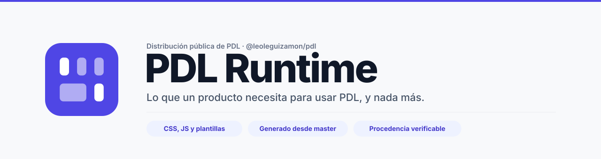
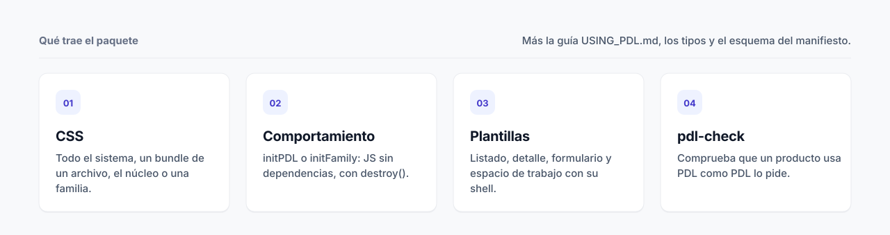
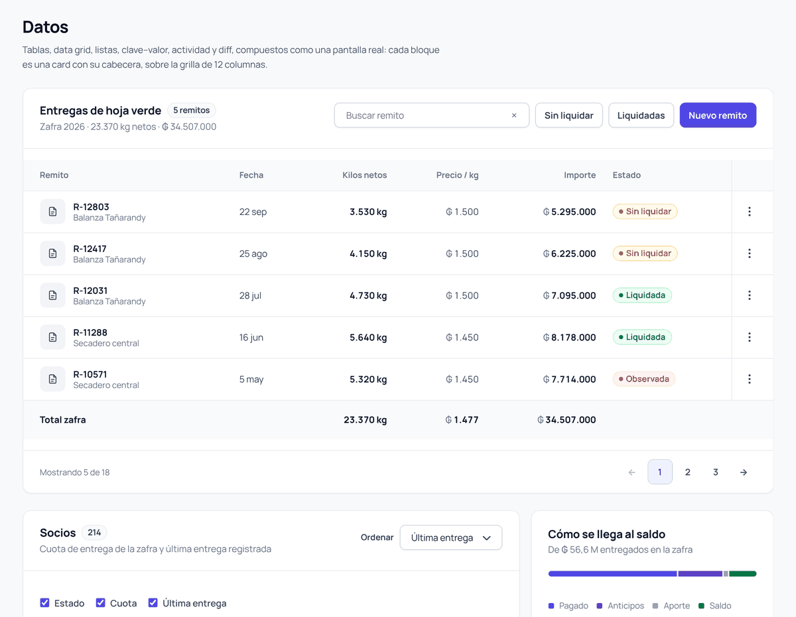
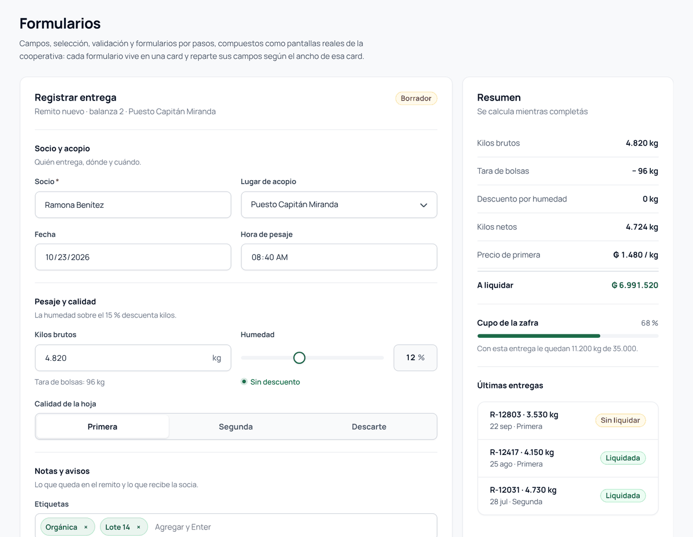
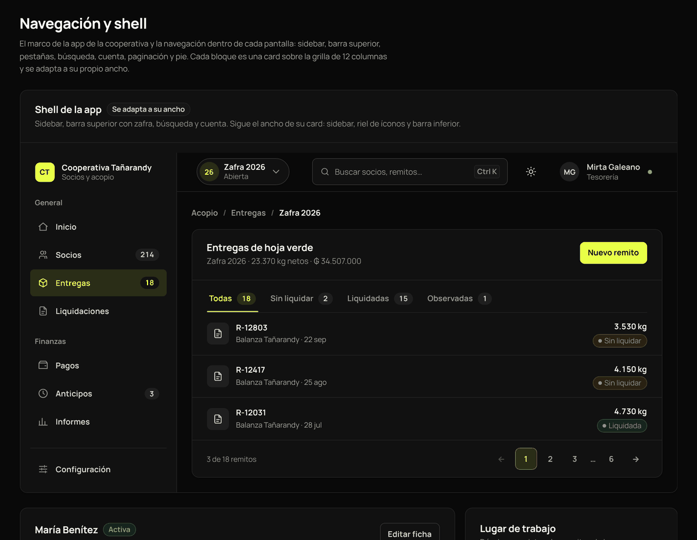
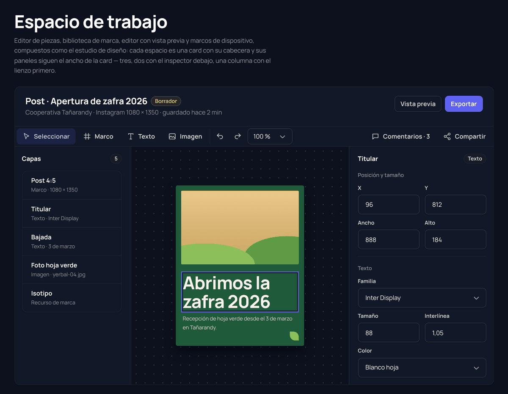
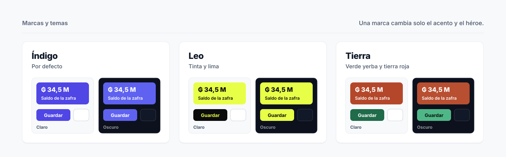
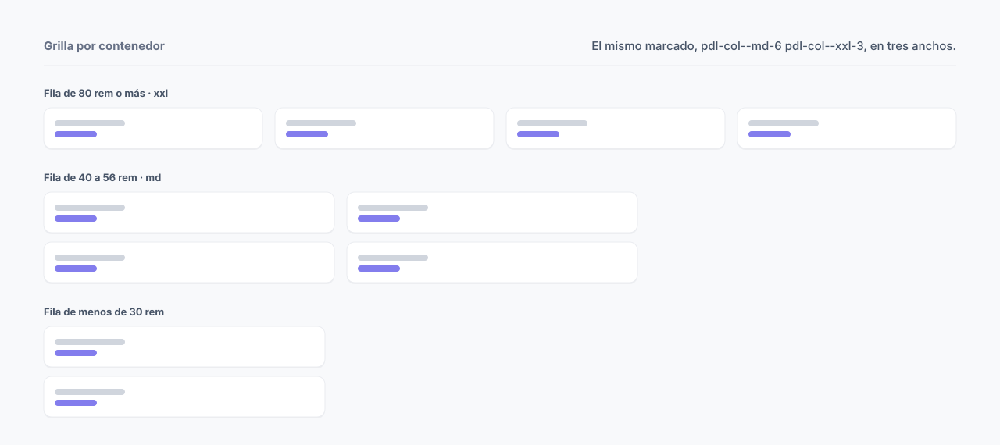
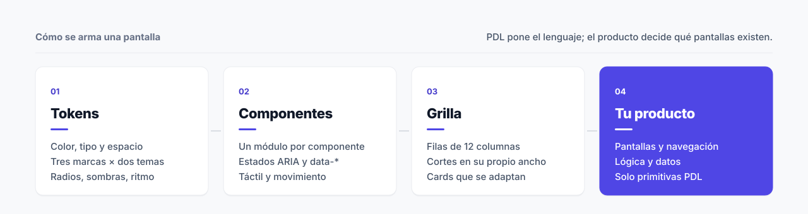

<div align="center">

<picture>
  <source media="(prefers-color-scheme: dark)" srcset="img/runtime_banner_dark.svg">
  
</picture>

[](RUNTIME_PROVENANCE.json)
[](https://github.com/leoleguizamonpy/PDL-RUNTIME/actions/workflows/verify.yml)
[](package.json)
[](package.json)

[Instalación](#instalación) &nbsp;·&nbsp; [Cómo se usa](#cómo-se-usa) &nbsp;·&nbsp; [Entradas](#entradas-del-paquete) &nbsp;·&nbsp; [Marcas](#marcas-y-temas) &nbsp;·&nbsp; [Grilla](#grilla-por-contenedor) &nbsp;·&nbsp; [Plantillas](#plantillas-y-pdl-check) &nbsp;·&nbsp; [Procedencia](#versiones-y-procedencia) &nbsp;·&nbsp; [Preguntas](#preguntas-frecuentes)

</div>

<br>

**PDL Runtime** es el paquete `@leoleguizamon/pdl`: la parte de PDL que un producto necesita para construir sus pantallas. Trae el sistema visual **PDL 2 «Preciso»** (tres marcas, claro y oscuro), el comportamiento de los componentes, las plantillas de página, la guía de uso y el verificador `pdl-check`.

> [!IMPORTANT]
> **Este repositorio se genera; no se edita.** Cada versión sale de un export con lista explícita desde la rama `master` de PDL, y `RUNTIME_PROVENANCE.json` registra la revisión exacta de origen. Los cambios se hacen en PDL y se vuelven a publicar.

<picture>
  <source media="(prefers-color-scheme: dark)" srcset="img/runtime_kit_dark.svg">
  
</picture>

<p>




</p>
<p align="center"><sub>Pantallas compuestas solo con PDL, con datos sintéticos de una cooperativa y de un estudio de diseño.</sub></p>

## Instalación

El paquete se instala desde este repositorio, fijado a una revisión exacta:

```bash
npm install github:leoleguizamonpy/PDL-RUNTIME#<revisión>
```

```json
{
  "dependencies": {
    "@leoleguizamon/pdl": "github:leoleguizamonpy/PDL-RUNTIME#<revisión>"
  }
}
```

> [!TIP]
> Fijá siempre un commit, no `main`. Así cada producto sabe exactamente qué versión de PDL usa y actualiza cuando decide hacerlo.

## Cómo se usa

```css
@import "@leoleguizamon/pdl/css";
```

```js
import { initPDL } from "@leoleguizamon/pdl";
const pdl = initPDL();               // enlaza el comportamiento de los componentes del documento
```

```html
<html data-pdl-brand="tierra">        <!-- sin atributo: Índigo; el tema sigue al sistema -->
  <form class="pdl-card">
    <header class="pdl-card__head"><div><h3 class="pdl-card__title">Registrar entrega</h3></div></header>
    <div class="pdl-row pdl-row--fit">
      <label class="pdl-field"><span class="pdl-label">Socio</span><input class="pdl-input"></label>
      <label class="pdl-field"><span class="pdl-label">Kilos</span><input class="pdl-input"></label>
    </div>
    <footer class="pdl-card__actions pdl-card__actions--end">
      <button class="pdl-button pdl-button--primary">Registrar</button>
    </footer>
  </form>
</html>
```

Sin bundler, se enlaza el archivo único y el módulo de entrada:

```html
<link rel="stylesheet" href="node_modules/@leoleguizamon/pdl/src/css/pdl.css">
<script type="module">
  import { initPDL } from "./node_modules/@leoleguizamon/pdl/src/index.js";
  initPDL();
</script>
```

La guía completa para construir pantallas es [`USING_PDL.md`](USING_PDL.md): proceso, plantillas, grilla, repartos por defecto, roles de texto, tamaños de control y qué no se hace en el producto.

> [!NOTE]
> **PDL no conoce el dominio.** Sabe qué es un formulario, no qué significa. Si para que algo se vea bien hace falta CSS propio en el producto, primero se busca el contrato de PDL que lo resuelve.

## Entradas del paquete

| Entrada | Uso |
| --- | --- |
| `@leoleguizamon/pdl/css` | Todo el sistema visual, módulo por módulo |
| `@leoleguizamon/pdl/css/bundle` | Lo mismo en un solo archivo, para productos sin bundler |
| `@leoleguizamon/pdl/css/core` | Solo el núcleo: fundamentos, composición de página, botones y cards |
| `@leoleguizamon/pdl/css/family/<familia>` | El núcleo, una familia y lo que esa familia necesita |
| `@leoleguizamon/pdl/js/family/<familia>` | `initFamily()`: solo los comportamientos de esa familia |
| `@leoleguizamon/pdl` | `initPDL`, feedback, toasts, splash, estados de carga |
| `@leoleguizamon/pdl/app` | App Runtime opcional (`createPDLApp`) |
| `@leoleguizamon/pdl/runtime` | Runtime de interacción sin la capa de app |
| `@leoleguizamon/pdl/notifications` · `/workspace` | Utilidades de notificaciones y de espacio de trabajo |
| `@leoleguizamon/pdl/manifest-schema` | Esquema JSON del manifiesto de producto |

```js
// Solo los formularios: CSS y comportamiento de la familia
import "@leoleguizamon/pdl/css/family/forms";
import { initFamily } from "@leoleguizamon/pdl/js/family/forms";
const forms = initFamily();          // forms.destroy() lo desactiva
```

<details>
<summary><b>Familias disponibles</b></summary>
<br>

| Familia | Entrada | Qué cubre |
| --- | --- | --- |
| Formularios | `forms` | Campos del alto de los botones, selección, validación, color, rango y formularios por pasos |
| Datos | `data` | Tabla, data grid, búsqueda y filtros, listas, clave-valor, actividad y diff |
| Navegación y shell | `navigation` | Sidebar, riel, barras, pestañas, paginación, paleta de comandos y cuenta |
| Capas | `overlays` | Diálogo, cajón, hoja inferior, menú, tooltip, popover y visor |
| Progreso y métricas | `progress` | KPI, gráficos, barras y anillos (solo CSS) |
| Feedback y carga | `feedback` | Avisos, toasts, estados vacíos y de error, esqueletos |
| Archivos | `files` | Explorador y subida |
| Planificación | `temporal` | Calendario, kanban y gantt |
| Espacio de trabajo | `workspace` | Editores con lienzo, biblioteca e inspector |
| Chat e IA | `ai` | Conversación, sugerencias y aprobaciones (solo CSS) |
| Páginas de enlaces | `link-pages` | Páginas de enlaces para teléfono (solo CSS) |
| Movimiento | `motion` | Entradas y cursor |
| App Runtime | `runtime` | Superficies declarativas y prototipos, con `@leoleguizamon/pdl/app` |

El núcleo (fundamentos, composición de página, acciones y cards) viaja con cada familia. Las familias solo CSS no tienen entrada JS; `initPDL()` sigue activando todo.
</details>

## Marcas y temas

<picture>
  <source media="(prefers-color-scheme: dark)" srcset="img/marcas_dark.svg">
  
</picture>

Un solo estilo, tres marcas. Una marca cambia solo el **acento** (botón principal, ítem actual, foco, selección) y el **héroe** (la cifra que encabeza una pantalla).

| Marca | Atributo | Acento | Héroe |
| --- | --- | --- | --- |
| Índigo | — | `#4f46e5` | índigo |
| Leo | `data-pdl-brand="leo"` | tinta `#0b0b0c` (lima en oscuro) | lima `#e8ff47` |
| Tierra | `data-pdl-brand="tierra"` | verde yerba `#1f6b4a` | tierra roja `#b4472a` |

Sin `data-pdl-theme`, PDL sigue al sistema; `light` o `dark` lo fijan. Un botón con `data-pdl-theme-toggle` alterna el tema y lo recuerda; desde JS, `setPDLTheme()` y `setPDLBrand()`.

## Grilla por contenedor

<picture>
  <source media="(prefers-color-scheme: dark)" srcset="img/grilla_dark.svg">
  
</picture>

**12 columnas** (u 8 con `data-pdl-columns="8"`), **gutter de 16 px** y los cortes de Bootstrap **sm · md · lg · xl · xxl**. Cada fila lee los cortes **en su propio ancho**: a pantalla completa coincide con Bootstrap; dentro de una card, un panel o una columna lateral, baja de paso sola.

| Pieza | Comportamiento |
| --- | --- |
| `.pdl-row` + `.pdl-col--md-6` | Columnas que cambian según el ancho de la fila (sm 30 · md 40 · lg 56 · xl 68 · xxl 80 rem) |
| `.pdl-row--fit` | Campos de a pares que siguen el ancho de su card |
| `.pdl-grid--4` · `--3` · `--2` | Colecciones 4 → 2 → 1, 3 → 1, 2 → 1, sin cards huérfanas |
| `.pdl-split--aside` | Contenido 9 + columna lateral 3; la lateral pasa abajo bajo 60 rem |
| Anchos laterales fijos | Riel 64 · sidebar 256 · panel 320 · cajón 448 px |

## Plantillas y pdl-check

<picture>
  <source media="(prefers-color-scheme: dark)" srcset="img/flujo_dark.svg">
  
</picture>

Las plantillas de [`templates/`](templates) traen el shell completo (sidebar con marca, barra superior con búsqueda, interruptor de tema, menú de cuenta, paleta de comandos y menú móvil). Se copian y se conserva su estructura.

| Pantalla | Plantilla |
| --- | --- |
| Colección para buscar, filtrar y ordenar | [`templates/listing.html`](templates/listing.html) |
| Un elemento con su estado y propiedades | [`templates/detail.html`](templates/detail.html) |
| Alta o edición en pasos | [`templates/form.html`](templates/form.html) |
| Herramienta con lienzo y paneles | [`templates/workspace.html`](templates/workspace.html) |

`pdl-check` comprueba que un producto usa PDL como PDL lo pide: breakpoints, tamaños, anchos, tipografía y espacios salen de PDL, y el CSS del producto solo compone.

```bash
npx pdl-check src/                    # reglas estáticas sobre .html y .css
npx pdl-check src/ --render           # además mide la grilla en Chromium (requiere playwright)
npx pdl-check src/ --json             # reporte para máquinas
```

Los errores rompen el estándar (salida 1); las advertencias merecen una mirada.

## Versiones y procedencia

```text
PDL master → export con lista explícita → PDL-RUNTIME
```

| Campo | Valor |
| --- | --- |
| Paquete | `@leoleguizamon/pdl` |
| Versión | `2.0.0-alpha.4` |
| Origen | `leoleguizamonpy/PDL`, rama `master` |
| Revisión de origen | `89a854ccf5950bbc9632916db19385d075b07c0e` |

La autoridad legible por máquinas es [`RUNTIME_PROVENANCE.json`](RUNTIME_PROVENANCE.json): versión, revisión exacta de origen, qué se incluye y qué queda fuera por diseño. Una versión publicada no se modifica; cada cambio es una versión nueva.

<details>
<summary><b>Qué incluye y qué no</b></summary>
<br>

| Incluye | Queda fuera por diseño |
| --- | --- |
| `src/`: CSS, JS, App Runtime, tipos y contratos HTML | Gobierno, fundamentos y hoja de ruta de PDL |
| `src/css/pdl.css`: el sistema en un archivo | Documentación interna del design system |
| `USING_PDL.md`, `templates/` y `bin/pdl-check.mjs` | Pruebas, playground, Studio y herramientas internas |
| `schemas/product-ui.schema.json` | Flujos de CI del repositorio de origen |
| `package.json` y `RUNTIME_PROVENANCE.json` generados | |

El export es una lista explícita, no un espejo: lo que no está en la lista no se publica.
</details>

## Preguntas frecuentes

<details>
<summary><b>¿Puedo cargar solo una parte?</b></summary>
<br>
Sí. <code>css/core</code> trae el núcleo y <code>css/family/&lt;familia&gt;</code> suma una familia con lo que necesita; <code>js/family/&lt;familia&gt;</code> hace lo mismo con el comportamiento.
</details>

<details>
<summary><b>¿Funciona sin JavaScript?</b></summary>
<br>
Lo visual sí: todo es CSS. El JS agrega comportamiento (menús, pestañas, paleta, validación). Lo que aparece con animación también se muestra sin script.
</details>

<details>
<summary><b>¿Cómo cambio de marca o de tema?</b></summary>
<br>
Con <code>data-pdl-brand="leo|tierra"</code> y <code>data-pdl-theme="light|dark"</code> en el <code>&lt;html&gt;</code>, o con <code>setPDLBrand()</code> y <code>setPDLTheme()</code>. Las tres marcas pasan la auditoría de accesibilidad WCAG 2.1 AA en los dos temas.
</details>

<details>
<summary><b>¿Puedo proponer cambios acá?</b></summary>
<br>
No en este repositorio: es salida generada y un cambio manual se pierde en la próxima publicación. Los hallazgos se resuelven en PDL y llegan en una versión nueva.
</details>

<details>
<summary><b>¿Quién decide las pantallas?</b></summary>
<br>
El producto: qué pantallas existen, su navegación, sus datos y su lógica. PDL pone tokens, componentes, grilla, accesibilidad y comportamiento genérico.
</details>

---

<sub>Manrope (SIL Open Font License) y JetBrains Mono para código · modelo de grilla y breakpoints de Bootstrap · ecosistema Leo Leguizamón</sub>
